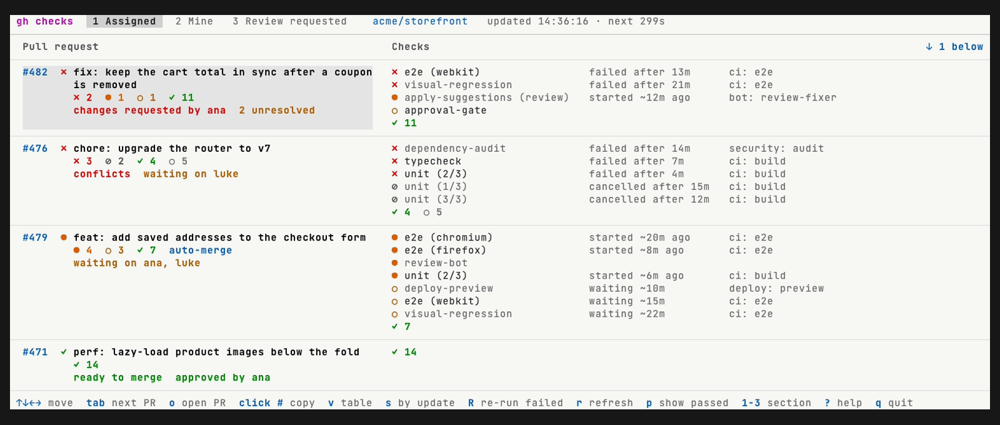

# gh checks

A [GitHub CLI](https://cli.github.com/) extension that shows your open pull
requests in a live terminal dashboard, with every CI check expanded.

GitHub's pull request list rolls all of a PR's checks into one icon, and keeps
showing a red ✗ while a failed job is being re-run. `gh checks` lays the checks
out as a table instead: one row per pull request, one column per workflow, so
you can see at a glance what is failing, what is running and what is queued.
A re-run replaces the earlier attempt, so a running re-run shows as running.



## Install

Requires `gh` (logged in with `gh auth login`) and Node.js 18 or later.

```sh
gh extension install esalaza/gh-checks
```

## Usage

```sh
gh checks                     # dashboard of your open PRs, refreshed every 30 s
gh checks -i 15               # refresh every 15 s
gh checks -R owner/repo       # one repo only
gh checks --all               # every repo, even inside a repo folder
gh checks | cat               # print the table once (any piped output)
```

Run inside a repository folder, it lists that repository's pull requests;
anywhere else, it lists them from every repository.

| Option | Meaning |
| --- | --- |
| `-R`, `--repo REPO` | Only pull requests in this repository |
| `--all` | Pull requests from every repository |
| `-i`, `--interval SECS` | Refresh interval (default 30, minimum 5) |
| `--show-passed` | Start with passed and skipped checks listed (they are counted, not listed, by default) |
| `--no-mouse` | Leave the mouse to the terminal, for normal text selection |
| `--light`, `--dark` | Colours for a light or dark background |
| `--bg COLOUR` | Window background while the dashboard runs, as `#rrggbb`, or `none` to keep the terminal's. Defaults to a neutral dark grey with the dark colours. Needs a terminal that supports it (iTerm2, Ghostty, kitty, VS Code); others keep their own |

### Keys

| Key | Action |
| --- | --- |
| `↑ ↓ ← →` or `k j h l` | Move between pull requests and checks |
| `tab`, `shift-tab` | Next / previous pull request |
| `g`, `G` | First / last pull request |
| `o`, `enter` | Open the selected pull request or check in the browser |
| `y` | Copy the selected pull request's number (`#123`) to the clipboard |
| `Y` | Copy the selected pull request's URL |
| `R` | Re-run failed jobs (the selected check, or the whole pull request) |
| `r` | Refresh now |
| `p` | Show / hide passed and skipped checks |
| `b` | Try the next background colour (the footer shows the `--bg` to keep it) |
| `1` `2` `3` | Assigned to me / Authored by me / Review requested |
| `?` | Help |
| `q`, `ctrl-c` | Quit |

With the mouse: click a pull request or check to select it, click it again to
open it, click a pull request's number (or right-click anywhere in its row) to
copy the number, scroll with the wheel and click a tab to switch sections. Hold Option
(macOS terminals) or Shift (most others) to select text.

### Symbols

| Symbol | Meaning |
| --- | --- |
| ✗ | Failed |
| ● | Running |
| ○ (yellow) | Queued |
| ⊘ | Cancelled |
| ✓ | Passed |
| ○ (grey) | Skipped |

Checks posted by apps rather than by a workflow appear under **Other checks**.

## Demo

`gh checks --demo` runs the dashboard on the made-up pull requests in
`demo.json` instead of your own. The GIF above is recorded from it with
[VHS](https://github.com/charmbracelet/vhs): run `vhs demo.tape` in this folder
to record it again after a change.
